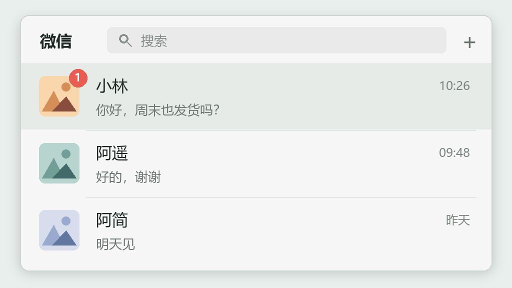
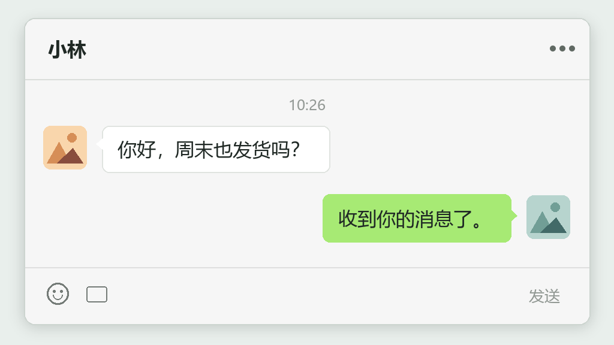
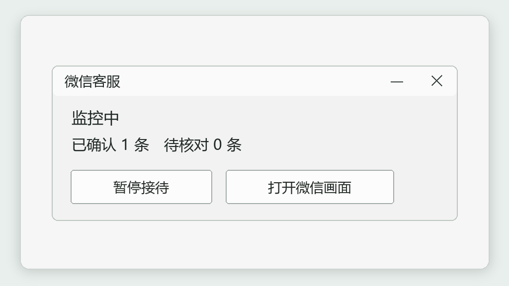

# WeChat Desk · 微信客服小窗

**后台监控微信新消息，在原私聊里自动回复。** 官方微信运行在独立的 WSL 桌面里。你可以继续在 Windows 上打字、切换窗口，也可以随时打开小窗查看接待状态。

## 新消息监控与自动回复

程序持续检查微信当前可见的会话列表，通过消息预览、时间和未读数的变化发现新消息。识别到新的私聊文字后，它会打开对应会话，核对最后一条来自对方，且输入框没有草稿，再以登录的微信号发送固定回执「收到你的消息了。」。

下面用同一条发货咨询演示接待过程。图中的联系人、消息和计数均为示例。

| 发现新消息 | 自动回复到原会话 |
| --- | --- |
|  |  |

确认自己的回复气泡出现在聊天里后，小窗会更新「已确认」计数。需要手动接待时，点「暂停接待」即可。



这是一个独立开发的个人微信界面自动化项目。微信协议第 8.2.1.6 条限制未经授权的第三方工具读取或控制客户端界面。使用此功能有账号受限或封禁风险。MIT 许可证适用于本仓库的原创代码，微信客户端及各依赖各自遵循其许可证和使用条款。[腾讯微信软件许可及服务协议](https://oper.my-qcloud.com/cgi-bin/readtemplate?lang=zh_CN&s=default&t=weixin_agreement)

## 安装

适用环境为 x86-64 Windows、可用的 WSL 2、Git 和可写的 D 盘。首次安装需要网络，安装完成后，后台接待依赖电脑保持唤醒、联网及客户端保持登录。如果尚未安装 WSL，在管理员 PowerShell 中执行 `wsl --install --no-distribution`，按系统提示重启，再用 `wsl --version` 检查。[微软 WSL 安装文档](https://learn.microsoft.com/zh-cn/windows/wsl/install)

在普通 PowerShell 中运行以下命令。新安装使用固定目录 `D:\WeChatDesk`。如果这个目录已有部署，请保留原目录和虚拟磁盘，使用已有安装的启动入口。

```powershell
git clone https://github.com/gonewiththesakura-creator/wechat-desk.git D:\WeChatDesk
cd D:\WeChatDesk
powershell.exe -NoProfile -ExecutionPolicy RemoteSigned -File .\setup\setup.ps1
```

安装脚本从上游下载 Debian WSL 镜像和腾讯 Linux 微信，并在使用前核对 SHA-256。已缓存的包放在 `packages/debian.wsl` 和 `packages/wechat.deb`。如腾讯替换下载地址对应的版本，校验会失败，需要重新验证客户端和对应哈希。脚本随后创建专用 WSL 2 发行版 `WeChatDesk` 并安装图形环境。[微信 Linux 版](https://linux.weixin.qq.com/)

## 使用

1. 打开小窗中的「打开微信画面」。如果查看器提示密码，输入本次弹窗显示的本机连接密码，再用手机扫码登录微信。
2. 登录后，程序会处理识别到的新私聊。可用另一个账号发一条明确的测试文字，在原聊天中核对回执。面板计数表示客户端界面已显示发出的回执，收件人的设备送达状态需由对方确认。
3. 点击「暂停接待」可停止处理，再点「恢复接待」即可继续。关闭面板或查看器后已启动的后台桌面会继续运行。

后续可运行 `powershell.exe -NoProfile -ExecutionPolicy RemoteSigned -File D:\WeChatDesk\setup\open.ps1` 打开面板。也可以用 Windows 自带的 .NET Framework 4.x 编译一个双击启动器，在仓库根目录执行：

```powershell
& "$env:WINDIR\Microsoft.NET\Framework64\v4.0.30319\csc.exe" /nologo /target:winexe /reference:System.Windows.Forms.dll /out:WeChatDesk.exe WeChatDeskLauncher.cs
```

如需在登录 Windows 后自动启动后台桌面，运行一次 `setup\enable-autostart.ps1`。要取消自启，在 Windows 任务计划程序中禁用「WeChatDesk Reception」。微信要求重新验证时，需要本人重新登录。

## 工作方式与边界

- WSL 中的 Xvfb 提供独立显示和输入，Openbox 管理窗口。noVNC 和 x11vnc 绑定本机回环地址，查看器需要临时密码。已登录桌面的访问者可以操作该微信。
- 接待程序通过 AT-SPI 读取可见会话和消息预览，核对聊天名称及私聊控件，再通过头像位置判断消息方向。确认输入框无草稿后发送固定文字，并回读自己的消息气泡。
- 已在 Debian 13 和 Linux 微信 4.1.13.29 中文界面验证私聊文字回执。群聊和部分系统会话会跳过。界面变化、连续来信、列表中不可见的会话或多端同时操作都可能导致漏回或误判。长期无人值守和全新机器安装尚待验证。
- 当前没有模型 API 集成。程序识别部分媒体占位文字，未实现图片内容理解、动态表情解析或语音转写。

## 本地数据

`control/status.json` 保存状态和计数，`control/paused` 是暂停标记。发送状态保存在 Linux 用户目录的 `wxdesk-receipts.sqlite3`，记录事件摘要和确认状态。微信客户端自己的登录及聊天数据位于发行版虚拟磁盘中。分享诊断信息时请勿上传 `debian/`、登录二维码、查看器密码或真实聊天截图。
